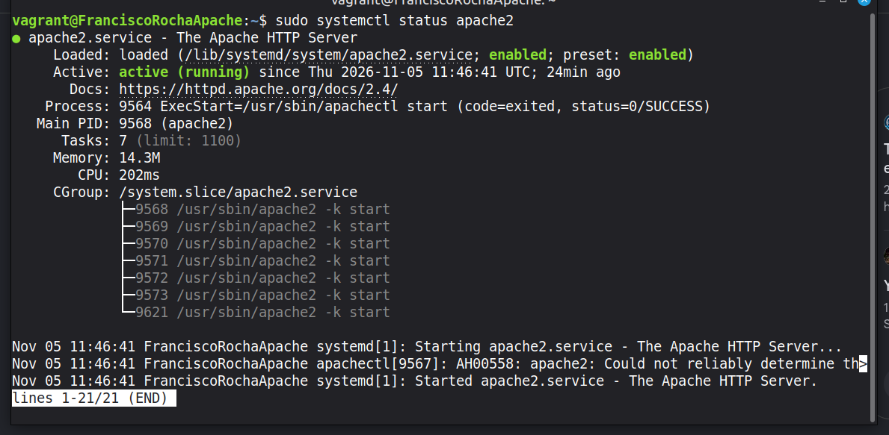
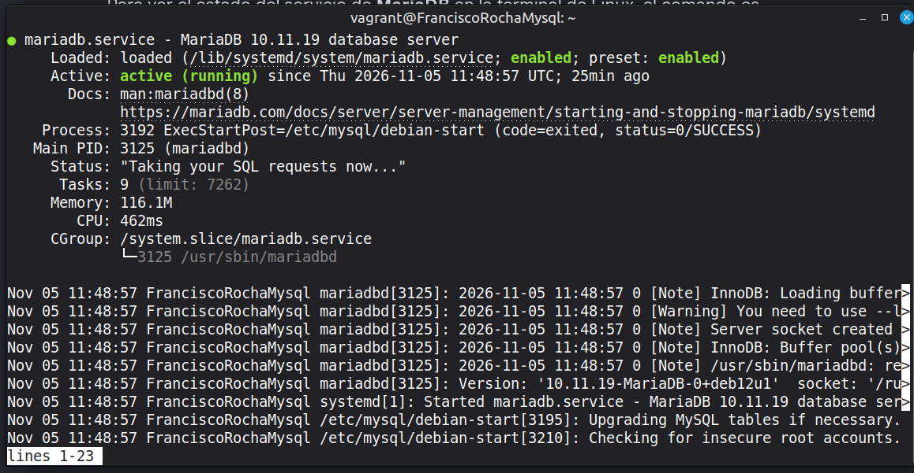

# Despliegue de Pila LAMP en Dos Niveles con Vagrant

Este documento técnico detalla la infraestructura y automatización para desplegar una aplicación web PHP con una base de datos centralizada utilizando **Debian 12** y **Vagrant**.

La arquitectura se divide en dos niveles independientes comunicados de forma segura a través de una red privada virtual:
* **Nivel de Aplicación:** Servidor web Apache con acceso a Internet para los clientes.
* **Nivel de Datos:** Servidor de bases de datos aislado, accesible únicamente por el servidor web.

---

##  Verificación del Sistema (Capturas de Pantalla)

### 1. Servidor de Aplicaciones (Apache corriendo)
A continuación se muestra el estado del servicio web activo y su correcta ejecución en la primera máquina virtual:



### 2. Servidor de Base de Datos (MariaDB corriendo)
A continuación se muestra el estado del servicio de base de datos activo en la segunda máquina virtual aislada:



### 3. Screencast con la aplicación desplegada
A continuación se muestra la grabación de pantalla que demuestra el correcto funcionamiento de la aplicación web interactuando con la base de datos:

https://github.com/user-attachments/assets/5e6d5a9e-45af-4bb1-92a2-5f9679f78ce0

---

##  Scripts de Aprovisionamiento Explicados

A continuación se desglosan los comandos utilizados en la automatización junto con la explicación detallada de cada orden.

###  1. Script del Servidor Web (`papache.sh`)

```bash
#!/bin/bash
# Fuerza al script a detenerse inmediatamente si ocurre algún error durante la ejecución.
set -e

# Configura las instalaciones de apt para que sean automáticas y no soliciten confirmaciones al usuario.
export DEBIAN_FRONTEND=noninteractive

# Actualiza el índice de paquetes locales con las últimas versiones de los repositorios.
apt-get update -y

# Instala el servidor web Apache, PHP, el módulo conector, el driver de MySQL para PHP y la herramienta Git.
apt-get install -y apache2 php libapache2-mod-php php-mysql git

# Limpia por completo el directorio raíz del servidor web eliminando el archivo index.html por defecto.
rm -rf /var/www/html/*

# Se desplaza al directorio temporal del sistema para trabajar de forma aislada.
cd /tmp

# Elimina cualquier rastro previo del repositorio de la práctica si existiera.
rm -rf iaw-practica-lamp

# Clona el repositorio con el código fuente de la aplicación web desde GitHub de forma local.
git clone https://github.com/josejuansanchez/iaw-practica-lamp.git

# Copia de forma recursiva todos los archivos de código PHP de la aplicación al directorio de Apache.
cp -r /tmp/iaw-practica-lamp/src/* /var/www/html/

# Reemplaza la constante DB_HOST en el archivo de configuración para apuntar a la IP del servidor de datos.
sed -i "s/define('DB_HOST', '.*');/define('DB_HOST', '192.168.56.20');/" /var/www/html/config.php

# Reemplaza el nombre de la base de datos objetivo con 'lamp_db'.
sed -i "s/define('DB_NAME', '.*');/define('DB_NAME', 'lamp_db');/" /var/www/html/config.php

# Reemplaza el usuario que se conectará con el nombre de usuario configurado 'lamp_user'.
sed -i "s/define('DB_USER', '.*');/define('DB_USER', 'lamp_user');/" /var/www/html/config.php

# Reemplaza la contraseña de conexión por la credencial compartida 'password_seguro'.
sed -i "s/define('DB_PASSWORD', '.*');/define('DB_PASSWORD', 'password_seguro');/" /var/www/html/config.php

# Cambia el propietario de los archivos web al usuario 'www-data' (el de Apache) para otorgar permisos de lectura/escritura correctos.
chown -R www-data:www-data /var/www/html/

# Reinicia el servicio de Apache para aplicar la configuración de PHP y cargar la aplicación limpiamente.
systemctl restart apache2
```

###  2. Script del Servidor de Base de Datos (`pmysql.sh`)

```bash
#!/bin/bash
# Detiene el script inmediatamente si algún comando devuelve un código de error.
set -e

# Evita pantallas interactivas durante la instalación de paquetes.
export DEBIAN_FRONTEND=noninteractive

# Actualiza el listado de paquetes del sistema operativo.
apt-get update -y

# Instala el motor de base de datos MariaDB (alternativa libre a MySQL) y Git.
apt-get install -y mariadb-server git

# Modifica la configuración de red de MariaDB para que escuche peticiones en la interfaz privada (IP .20) en lugar de local (127.0.0.1).
sed -i 's/^bind-address.*/bind-address = 192.168.56.20/' /etc/mysql/mariadb.conf.d/50-server.cnf

# Reinicia el servicio de MariaDB para que empiece a escuchar en la nueva dirección IP de la red privada.
systemctl restart mariadb

# Comando SQL para crear la base de datos de la práctica si no existe previamente.
mysql -e "CREATE DATABASE IF NOT EXISTS lamp_db;"

# Crea un usuario específico asignándole una contraseña, restringiendo su acceso únicamente desde la IP del servidor web (.10).
mysql -e "CREATE USER IF NOT EXISTS 'lamp_user'@'192.168.56.10' IDENTIFIED BY 'password_seguro';"

# Otorga privilegios completos de lectura, inserción y modificación al usuario sobre la base de datos 'lamp_db'.
mysql -e "GRANT ALL PRIVILEGES ON lamp_db.* TO 'lamp_user'@'192.168.56.10';"

# Limpia los privilegios en memoria para asegurar que las nuevas reglas de acceso surtan efecto inmediato.
mysql -e "FLUSH PRIVILEGES;"

# Accede a la carpeta temporal del sistema.
cd /tmp

# Elimina restos antiguos del repositorio para evitar conflictos de carpetas.
rm -rf iaw-practica-lamp

# Clona el mismo repositorio GitHub para obtener el archivo de volcado SQL de la base de datos.
git clone https://github.com/josejuansanchez/iaw-practica-lamp.git

# Importa de manera automatizada las tablas y datos iniciales del archivo 'database.sql' dentro de nuestra base de datos local.
mysql lamp_db < /tmp/iaw-practica-lamp/db/database.sql
```
